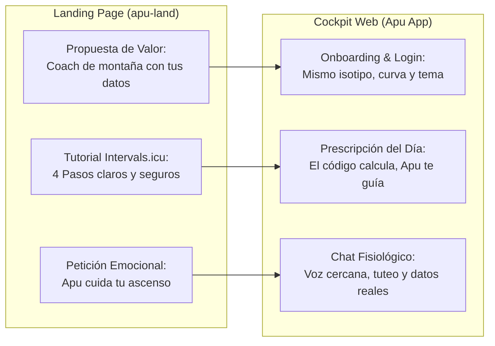
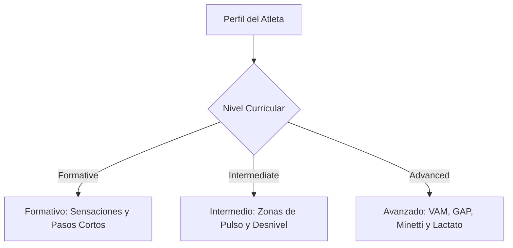
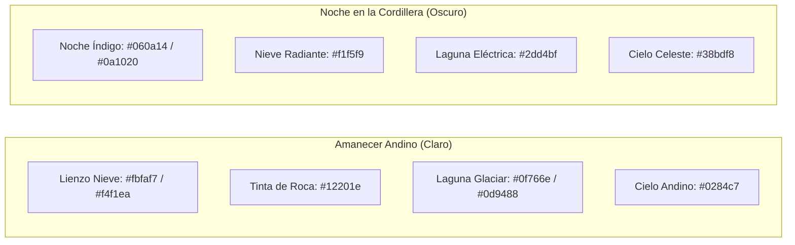
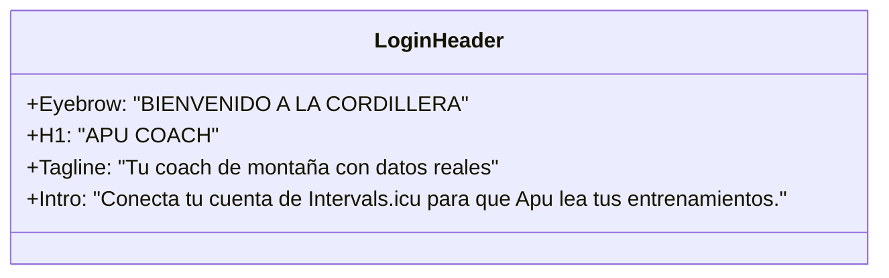

# Manual de Marca, Sistema de Estilos y Reporte de Armonización UI/UX: Landing Page & Cockpit Apu Coach

**Documento:** [`docs/landing.md`](file:///Users/luisalfredopilco/Documents/Antigravity-projects/ai-sports-coach/docs/landing.md)  
**Landing Page Oficial:** [https://apu-land.netlify.app/#apu](https://apu-land.netlify.app/#apu)  
**Aplicación / Cockpit:** [`frontend/index.html`](file:///Users/luisalfredopilco/Documents/Antigravity-projects/ai-sports-coach/frontend/index.html)  
**Tokens y Sistema de Estilos:** [`frontend/css/variables.css`](file:///Users/luisalfredopilco/Documents/Antigravity-projects/ai-sports-coach/frontend/css/variables.css)  
**Fecha de Publicación:** 2026-11-02  
**Estado:** Canónico / Aprobado  

---

## 1. Resumen Ejecutivo y Visión Estratégica

La landing page de **Apu Coach** (`https://apu-land.netlify.app/#apu`) ha establecido con éxito una identidad de marca andina de alta gama, que combina ciencia deportiva rigurosa, respeto por la montaña y cercanía humana. 

El presente manual unifica la **voz, tono, identidad visual, jerarquía tipográfica, copywriting y tratamiento al atleta** entre la landing page pública y la aplicación web (*Cockpit*), eliminando inconsistencias históricas (como la denominación «deportólogo», incompatibilidades en nombres de presets y discrepancias en taglines) para forjar una experiencia de usuario continua, coherente y profesional.



---

## 2. Plataforma de Marca (Brand Identity)

### 2.1. Naming y Raíces Culturales
- **Apu (Quechua):** El espíritu tutelar que habita las cumbres. En la cosmovisión andina, la montaña que cuida, enseña y exige humildad, preparación y respeto a quien la desafía.
- **Coach:** El entrenador analítico de resistencia que lee telemetría biológica, decide con ciencia y acompaña al atleta en cada zancada.
- **Anclaje de Origen:** *«Hecho en Quito · 2.850 m»*. El origen geográfico otorga credibilidad técnica inmediata en altitud, hipoxia, aclimatación y desnivel.

### 2.2. Arquitectura de Mensajes Canónicos

| Nivel de Mensaje | Copy Canónico Oficial | Contexto de Uso |
| :--- | :--- | :--- |
| **Claim Primario** | *«Tu coach de montaña con tus datos reales.»* | Hero de Landing y cabeceras de bienvenida. |
| **Claim Secundario** | *«El guardián de tus datos. El maestro de tu desnivel.»* | OpenGraph, subtítulo de login y branding exterior. |
| **Propuesta Funcional** | *«Lee tu reloj. Calcula con ciencia. Te dice qué entrenar hoy.»* | Subhead de conversión directa. |
| **Principio Tecnológico** | *«El código calcula. Apu te lo explica.»* | Sección de funcionamiento, confianza y seguridad. |
| **Salvaguarda / Escudo** | *«Cuando tu cuerpo dice no, Apu también.»* | Bloque anti-lesiones y estados de sobrecarga (ACWR > 1.5). |

### 2.3. Arquetipo de Marca y Persona
- **Arquetipo:** **El Sabio Compañero de Cordada** (*The Sage + The Mountain Guide*).
- **Rasgos de Personalidad:**
  - **Experto pero humilde:** Conoce la fisiología del esfuerzo y la inclemencia del clima, pero nunca habla con arrogancia.
  - **Franqueza andina:** No dora la píldora. Si los datos indican riesgo de lesión o tormenta, lo dice con serenidad y firmeza («Hoy no se puede»).
  - **Cero charlatanería de IA:** Jamás saluda con «Hola, soy un modelo de lenguaje de IA, ¿en qué te asisto?». Habla como tu coach personal de confianza al recibirte por la mañana.
  - **Empático y protector:** Valora el descanso tanto como el esfuerzo. Reconoce el esfuerzo de madrugar con frío y respira el ritmo de la montaña.

---

## 3. Manual de Copywriting, Voz y Tono

### 3.1. Persona Gramatical y Tratamiento al Atleta
- **Persona:** **Segunda persona del singular (Tú)**.
- **Tratamiento:** Cercano, directo, respetuoso, libre de tics corporativos o formalismos acartonados («usted»).
- **Tratamiento de género:** Neutro por defecto si no se conoce el sexo biológico o preferencia (`«te veo con energía»` en vez de `«te veo fresco»`). Al identificarse atleta femenina en fase menstrual, se activa empatía fisiológica validando síntomas sin forzar intensidades.

### 3.2. Los Tres Terrenos Fisiológicos
El contenido de Apu Coach habla el dialecto exacto de tres disciplinas deportivas:

1. **Asfalto (10K, Media, Maratón):** Enfoque en economía de carrera, cadencia (175–185 ppm), control de ritmos en llano, umbral de lactato y afinamiento (*tapering*) para no llegar con piernas pesadas.
2. **Trail Running (Media y Ultra Distancia):** Ritmo ajustado a pendiente (GAP polinómico de Minetti), desniveles acumulados ($D+$ y $D-$), uso táctico de bastones, pacing por tramos sobre tracks GPX y técnica excéntrica de bajada.
3. **Andinismo y Alta Montaña:** Aclimatación progresiva, respuesta cardíaca ante hipoxia (> 1.500 m y > 2.850 m), pronóstico meteorológico severo a 16 días (ECLIPSE) y regla de oro de la cordada: ante mal de montaña o tormenta, la cumbre se pospone y la prioridad es descender.

### 3.3. Adaptación Curricular Tri-Nivel (`data-curricular-level`)



- **Formativo (`formative`):**
  - *Cómo se habla:* Sin jerga deportiva fría. Si se menciona ACWR, se traduce de inmediato: *«lo que vienes entrenando frente a lo que tu cuerpo tolera hoy»*. La intensidad se guía por sensaciones (*«un ritmo en el que puedas conversar con soltura»*).
- **Intermedio (`intermediate`):**
  - *Cómo se habla:* Retos estructurados con zonas de frecuencia cardíaca (Z1 a Z5), tiempos de series y bloques de fuerza/cuestas. Explica brevemente la relación entre fatiga (ATL) y condición física (CTL).
- **Avanzado (`advanced`):**
  - *Cómo se habla:* Rigor técnico, analítico y directo al grano. Tiempos por kilómetro corregidos por pendiente (GAP), VAM (velocidad de ascenso en m/h), milimoles de lactato estimados, modelado de fatiga Banister y micro-estrategia por waypoints GPX.

### 3.4. Glosario Canónico de Términos (Qué usar vs. Qué evitar)

| Concepto | Término Obligatorio | Término Prohibido | Motivo |
| :--- | :--- | :--- | :--- |
| **El Rol de Apu** | **Tu coach de montaña** / **Apu** | *Tu deportólogo* / *Médico virtual* | Evita contingencia legal y médica; Apu asesora el entrenamiento, no medica. |
| **La Carrera** | **Meta** | *Objetivo* / *Target* / *Competencia* | Consistencia de interfaz: «Guardar meta», «Días a la meta». |
| **Acción de Enviar** | **Guardar** | *Registrar* / *Actualizar* / *Enviar* | Verbo directo y unívoco en botones («Guardar check-in»). |
| **Actividades GPS** | **Subir .FIT / .GPX** | *Importar* / *Cargar* / *Subir archivo* | Claridad técnica en el formato exacto. |
| **Eliminar Datos** | **Borrar** | *Eliminar* / *Limpiar* / *Descartar* | Palabra más concisa y reconocible. |
| **Sobrecarga Fisiológica** | **Descarga activa** / **Reposo** | *Castigo* / *Bloqueo de seguridad* | Enfoque fisiológico positivo para el atleta. |
| **Plataforma de Relojes**| **Intervals.icu** | *Intervalos* / *ICU* | Nombre propio de la plataforma proveedora. |

---

## 4. Sistema de Diseño Visual y Manual de Estilos

El sistema de estilos de Apu Coach es dual: **Amanecer Andino** (Modo Claro) y **Noche en la Cordillera** (Modo Oscuro). La única fuente de verdad en código es [`frontend/css/variables.css`](file:///Users/luisalfredopilco/Documents/Antigravity-projects/ai-sports-coach/frontend/css/variables.css).

### 4.1. Isotipo Vectorial Oficial (`#apu-iso`)

El símbolo oficial de Apu Coach funde tres conceptos en un trazo geométrico continuo:
1. **El Bocadillo de Chat:** La comunicación conversacional bidireccional entre atleta y coach.
2. **Las Tres Cumbres Andinas:** El relieve montañoso, el desnivel y la superación personal.
3. **El Sol Naciente Andino (*Inti*):** La energía vital diurna, la claridad y el inicio de cada jornada.

```html
<!-- Invocación canónica del isotipo con clase semántica -->
<svg class="mark" aria-hidden="true">
  <use href="#apu-iso"/>
</svg>
```

- **Color del Isotipo:** Vinculado dinámicamente al token `--iso` (`#0d9488` en claro, `#2dd4bf` en oscuro).
- **Área de Aislamiento:** Mínimo 25% del ancho del isotipo libre de otros elementos a su alrededor.

### 4.2. Paleta de Colores Dual y Semiótica Fisiológica



#### Especificación Numérica de Tokens

| Rol Semántico | Token CSS | Amanecer Andino (Claro) | Noche en la Cordillera (Oscuro) | Criterio de Uso |
| :--- | :--- | :--- | :--- | :--- |
| **Fondo Base** | `--bg` / `--bg-primary` | `#fbfaf7` / `#f4f1ea` | `#060a14` / `#0a1020` | Lienzo estructural sin parpadeos. |
| **Superficie Tarjetas**| `--surface` / `--bg-card` | `#ffffff` (94% opacidad) | `#0f1729` (82% opacidad) | Paneles glassmorphic con blur. |
| **Texto Primario** | `--text` / `--text-primary` | `#12201e` (Contraste 14.8:1) | `#f1f5f9` (Contraste 16.2:1) | Títulos, lecturas de datos principales. |
| **Texto Secundario**| `--muted` / `--text-muted` | `#566a6b` (Contraste 4.9:1) | `#8f9ab0` (Contraste 5.5:1) | Eyebrows, leads, hints y leyendas. |
| **Marca Principal** | `--brand` / `--iso` | `#0f766e` / `#0d9488` | `#2dd4bf` | Laguna glaciar andina. |
| **Acento de Cielo** | `--brand-2` / `--accent-sky` | `#0284c7` | `#38bdf8` | Cielo andino, enlaces, telemetría de aire. |
| **Estado Óptimo** | `--safe` / `--status-safe` | `#15803d` / `#16a34a` | `#4ade80` | ACWR 0.8–1.3, descanso óptimo, luz verde. |
| **Estado Alerta** | `--warn` / `--status-warning` | `#b45309` / `#d97706` | `#fbbf24` | Fatiga moderada, ACWR 1.3–1.5, TSB negativo. |
| **Estado Peligro** | `--danger` / `--status-danger`| `#b91c1c` / `#dc2626` | `#f87171` | **ACWR > 1.5**, sobrecarga, UV extremo. |

#### Gradientes Oficiales
- **Gradiente Glaciar (Marca):**  
  `linear-gradient(100deg, #0d9488 10%, #0284c7 90%)` (Claro)  
  `linear-gradient(100deg, #2dd4bf 10%, #38bdf8 90%)` (Oscuro)
- **Gradiente Volcánico (Alerta / Escudo):**  
  `linear-gradient(100deg, #ea580c 10%, #dc2626 90%)` (Claro)  
  `linear-gradient(100deg, #fb923c 10%, #f87171 90%)` (Oscuro)

### 4.3. Tipografía Dual Oficial

1. **`Plus Jakarta Sans`:**
   - Tipografía principal para titulares, navegación, cuerpo de texto, formularios y botones.
   - Proporciona una geometría moderna, neutral y altamente legible en pantallas móviles y desktop.
2. **`JetBrains Mono`:**
   - Tipografía táctica para **todos los datos numéricos y telemetría**: ACWR (`0.89`), TSB (`+5.0`), sueño (`7h 24`), temperatura (`4°C`), ritmos (`4:45/km`), altitud (`2.850 m`) y códigos de atleta.
   - Asegura ancho uniforme en números, facilitando la comparación vertical de métricas.

#### Jerarquía Tipográfica y Escala

```css
/* Escala tipográfica unificada */
h1 { font-size: clamp(2.2rem, 6vw, 4.5rem); font-weight: 800; letter-spacing: -0.025em; line-height: 1.08; }
h2 { font-size: clamp(1.8rem, 4.5vw, 3rem); font-weight: 800; letter-spacing: -0.02em; line-height: 1.12; }
h3 { font-size: clamp(1.2rem, 2.5vw, 1.5rem); font-weight: 700; letter-spacing: -0.01em; line-height: 1.25; }
.eyebrow { font-size: 0.875rem; font-weight: 700; text-transform: uppercase; letter-spacing: 0.05em; color: var(--brand); }
.lead { font-size: clamp(1.05rem, 1.8vw, 1.25rem); color: var(--muted); line-height: 1.5; }
.mono-metric { font-family: var(--mono); font-weight: 700; }
```

### 4.4. Componentes y Morfología Visual

- **Píldoras Interactivas (`border-radius: 999px`):** Reservadas exclusivamente para elementos clickeables y de acción principal (botones primarios, botón empezar, filtros de tabulador).
- **Placas de Hito (`tags` con corte biselado diagonal):** Elementos de telemetría e informativos (estados fisiológicos: `RECUPERADO`, `EN RANGO`, `SOBRECARGA`). No parecen botones, impidiendo falsos clicks.
- **La Cordillera (Cockpit de 7 Cumbres):** Cada cumbre del SVG de fondo corresponde a una dimensión del rendimiento del atleta:
  1. Carga (ACWR)
  2. Forma (TSB / Fatiga)
  3. Recuperación (Sueño + VFC + Check-in matutino)
  4. Microciclo (Planificación semanal por fases)
  5. Meta (Días a la prueba, perfil GPX y afinamiento)
  6. Clima (Pronóstico de cumbre a 16 días)
  7. Progreso (Histórico semanal y mensual comparado)

- **Presets de Módulos (Workspace Adaptable):**
  - **Campamento Base:** Vista minimalista centrada en el chat con Apu.
  - **Ruta Clásica:** Lo esencial para el día a día (Semáforo hoy + Carga + Recuperación).
  - **Cumbre:** La cordillera completa con los 7 hitos activos.

---

## 5. Auditoría de Coherencia: Landing Page vs. Aplicación (Cockpit)

Tras contrastar [`frontend/index.html`](file:///Users/luisalfredopilco/Documents/Antigravity-projects/ai-sports-coach/frontend/index.html), [`frontend/css/variables.css`](file:///Users/luisalfredopilco/Documents/Antigravity-projects/ai-sports-coach/frontend/css/variables.css) y la landing en vivo (`https://apu-land.netlify.app/#apu`), se han identificado las siguientes discrepancias y oportunidades de mejora:

| Área Auditada | Estado en Landing Page | Estado Actual en App / Cockpit | Diagnóstico & Solución Recomendada |
| :--- | :--- | :--- | :--- |
| **Rol de Apu en el Chat** | *«Tu coach de montaña con IA»* / *«Apu Coach no sustituye a tu médico»* | `<h3>Apu · Tu deportólogo</h3>` ([index.html#L461](file:///Users/luisalfredopilco/Documents/Antigravity-projects/ai-sports-coach/frontend/index.html#L461)) | **Incoherencia de alto riesgo:** Llamar «deportólogo» a la IA crea riesgo legal/médico y contradice la landing. **Mejora:** Renombrar en la app a `Apu · Tu coach de montaña`. |
| **Subtítulo de Login** | *«Tu coach de montaña. Con tus datos reales.»* | `Inteligencia fisiológica de montaña` ([index.html#L97](file:///Users/luisalfredopilco/Documents/Antigravity-projects/ai-sports-coach/frontend/index.html#L97)) | **Desconexión tonal:** «Inteligencia fisiológica» suena abstracto. **Mejora:** Usar el subtítulo canónico de la landing: `Tu coach de montaña con datos reales`. |
| **Nombres de Presets de Módulos** | `Campamento base`, `Ruta clásica`, `Cumbre` (Pestaña El Coach) | En algunos selectores internos figuran nombres genéricos (`compact`, `focus`). | **Mejora:** Estandarizar la tríada andina `Campamento base`, `Ruta clásica` y `Cumbre` en el modal de personalización de módulos. |
| **Meta vs Objetivo** | Se usa `Meta` en títulos y pasos | En algunos modelos de backend persiste `target_goal` u «objetivo». | **Mejora:** Confirmar que en la interfaz visual hacia el atleta el término visible sea siempre `Tu meta`. |
| **Tutorial de Conexión Intervals.icu** | 4 Pasos detallados con capturas reales y advertencia clara sobre Strava | El login de la app solo tiene dos inputs y un link externo genérico a Intervals.icu. | **Mejora:** Añadir en el login de la app un enlace contextual visible: `¿Cómo conectar tu reloj en 4 pasos? Ver tutorial`. |
| **Muro de Aportes / Feedback** | En landing existe el muro interactivo con categorías: *Mejora*, *Error*, *Idea*, *Experiencia*. | En la app el feedback se limita a un formulario modal de reporte. | **Mejora:** Compartir los mismos 4 tipos de aportes en el diálogo de feedback del cockpit. |

---

## 6. Guía de Títulos, Encabezados y Jerarquías (UI Copywriting)

### 6.1. Pantalla de Bienvenida y Acceso (Login Gate)



- **Eyebrow:** `BIENVENIDO A LA CORDILLERA`
- **H1:** `APU COACH`
- **Subtítulo:** `Tu coach de montaña con tus datos reales`
- **Párrafo Guía:** `Conecta tu cuenta de Intervals.icu para que Apu lea tu reloj, evalúe tu fatiga y te diga qué hacer hoy.`
- **Píldoras de Privacidad (Footer de login):**
  - *Claves cifradas:* «Tus claves se guardan bajo cifrado AES-256».
  - *GPS recortado:* «Se recortan 500 m al inicio y fin de tus rutas».
  - *Identidad anónima:* «Tu usuario se identifica solo mediante UUIDv4».

### 6.2. Cabecera del Chat y Consola Principal

- **Título Principal del Chat:** `Apu · Tu coach de montaña` (Sustituyendo el previo `Apu · Tu deportólogo`).
- **Estado Dinámico:**
  - `En línea · Analizando tus datos`
  - `Escribiendo…`
  - `Descanso sugerido · ACWR alto`
- **Burbuja de Bienvenida Inicial:**
  > *«Hola, Ana. Ya revisé tus entrenamientos recientes en Intervals.icu. Hoy tu carga aguda está equilibrada (ACWR 0.89) y tu sueño marcó 7h 24m. ¿Cómo sientes las piernas para el fondo de este fin de semana?»*

### 6.3. Tarjetas del Cockpit y Paneles Desplegables

| Módulo / Cumbre | Eyebrow Canónico | Título de Tarjeta (H3) | Micro-copy Descriptivo |
| :--- | :--- | :--- | :--- |
| **Decisión de Hoy** | `EN UN VISTAZO` | **Qué hacer hoy** | La sesión del día según tu carga, sueño y clima. |
| **Carga Aguda** | `MÉTRICA CLAVE` | **Ratio de carga (ACWR)** | Relación entre tu fatiga de los últimos 7 días y tu base de 28 días. |
| **Forma** | `FRESCURA` | **Forma actual (TSB)** | Diferencia entre tu capacidad aeróbica y tu cansancio acumulado. |
| **Recuperación** | `BIENESTAR` | **Recuperación diaria** | Horas de sueño, variabilidad cardíaca (VFC) y tu check-in matutino. |
| **Microciclo** | `PLAN SEMANAL` | **Microciclo semanal** | Tu volumen programado versus los kilómetros y desnivel realizados. |
| **Meta y Tapering**| `RUMBO A LA CUMBRE` | **Tu meta** | Cuenta regresiva, ritmo ajustado a desnivel (GAP) y afinamiento. |
| **Clima de Cumbre** | `PRONÓSTICO 16 DÍAS`| **Clima de montaña** | Radiación UV, lluvia, viento y temperatura en tu ruta. |
| **Progreso** | `HISTORIAL` | **Progreso e hitos** | Comparativa semana a semana y asimilación de cargas. |

---

## 7. Plan de Acción y Mejoras Recomendadas

### 7.1. Mejoras en la Aplicación Web (`frontend/`)
1. **Actualizar el encabezado del chat en [`frontend/index.html`](file:///Users/luisalfredopilco/Documents/Antigravity-projects/ai-sports-coach/frontend/index.html#L461):**
   Reemplazar `Apu · Tu deportólogo` por `Apu · Tu coach de montaña` (y actualizar la prueba en [`backend/tests/test_ui_chat_apu.py`](file:///Users/luisalfredopilco/Documents/Antigravity-projects/ai-sports-coach/backend/tests/test_ui_chat_apu.py) para mantener el 100% de tests en verde).
2. **Homogeneizar el subtítulo de Login:**
   Cambiar `Inteligencia fisiológica de montaña` por `Tu coach de montaña con datos reales`.
3. **Incorporar el enlace directo al Tutorial de Conexión:**
   En el formulario de acceso, agregar un enlace a `https://apu-land.netlify.app/#conectar`: *«¿Primera vez? Mira cómo conectar tu reloj en 4 pasos»*.
4. **Armonizar Presets de Workspace:**
   Asegurar que los nombres en el menú de módulos sean exactamente:
   - *Campamento base* (Solo chat)
   - *Ruta clásica* (Esencial: Hoy + Carga + Recuperación)
   - *Cumbre* (Los 7 hitos)

### 7.2. Mejoras en la Landing Page (`apu-land`)
1. **Enlace bidireccional al Cockpit:**
   Habilitar el botón `.app-link` en el Paso 4 del tutorial (`#paso-4`) apuntando al dominio de producción del Cockpit.
2. **Persistencia del Muro de Comunidad:**
   Conectar el formulario de aportes de la comunidad a la API de Supabase o Google Sheets para que los atletas puedan ver aportes de otros corredores en tiempo real.
3. **Micro-video de Demostración del Escudo Anti-lesiones:**
   Añadir el extracto auditado en el banner oscuro para ilustrar cómo el semáforo cambia de verde a rojo cuando el ACWR supera 1.5.

---

## 8. Conclusión

Con la implementación de este manual, **Apu Coach** consolida una identidad singular y robusta: una herramienta de ingeniería fisiológica rigurosa nacida a 2.850 metros de altura que habla con calidez de montaña, respeta al atleta, protege su salud con salvaguardas inviolables y ofrece una experiencia visual y narrativa idéntica desde su primer contacto en la landing page hasta el entrenamiento diario en el cockpit.

